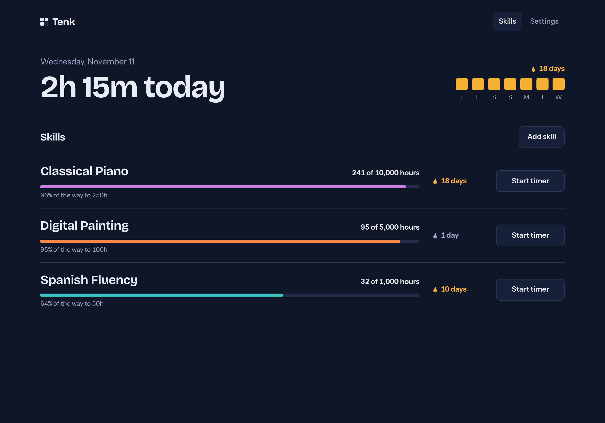
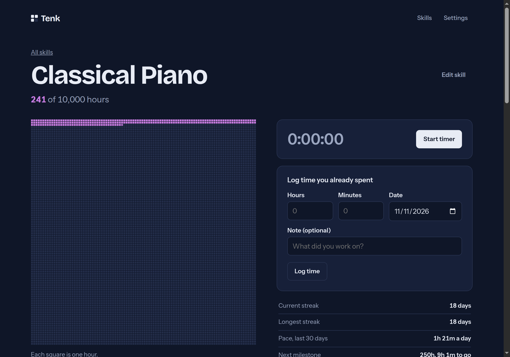
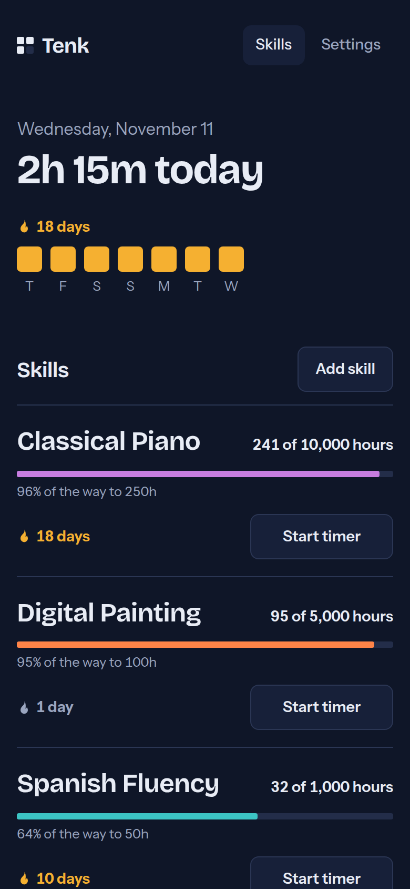

# Tenk — 10,000 Hours Tracker

> **Track the hours you put into a skill on the way to 10,000.**

[](https://github.com/himel7009/tenk-hours/actions/workflows/deploy.yml)
[](https://himel7009.github.io/tenk-hours/)
[](LICENSE)

**[✨ View Live Demo ✨](https://himel7009.github.io/tenk-hours/)**

Tenk is a clean, distraction-free web app and PWA for mastering any craft. Add a skill, time your practice sessions or log them manually, and watch a grid of 10,000 squares fill in hour by hour. Tenk also tracks daily streaks, a 26-week activity heatmap, milestone achievements, and projected finish dates based on your recent pace.

Tenk works without an account, storing everything in your browser. Sign in with Google or an email and password and your data syncs across your devices.

---

## 📸 Demo & Screenshots

### 1. Dashboard & Skills Overview
Track today's practice at a glance, maintain your active streak, and monitor your full skill portfolio.



### 2. Deep-Dive Skill Tracker
Visualise your 10,000-hour journey with an interactive practice timer, milestone ladder, 26-week activity heatmap, pace calculation, and session history.



### 3. Responsive & Mobile-Ready (PWA)
Optimised for mobile, tablet, and desktop screens with dark and light theme support.

<p align="center">
  
</p>

---

## ⚡ Features

- **🎯 Skills and Habits**: Track long-term skills towards 10,000 hours and daily habits side by side, each with its own icon and colour.
- **⏱ Countdown Timer**: Set a timer for a session (25m, 1h, 2h or your own length); it saves itself when it ends. Stopwatch and manual logging are there too.
- **⬛ 10,000-Hour Visual Grid**: Every single hour completed is reflected visually on your skill field.
- **🔥 Per-Skill Streaks & Daily Goals**: Every skill and habit has its own streak. A day only counts once you reach its daily goal (one hour by default).
- **🎯 Milestone Progress**: Step-by-step milestones (1h, 10h, 50h, 100h, 250h, 500h, 1,000h, 2,500h, 5,000h, 7,500h, 10,000h).
- **📅 26-Week Heatmap**: GitHub-style activity calendar for each skill.
- **🔮 Finish Date Projections**: Automatically estimates when you'll reach your target based on recent consistency.
- **☁️ Optional Cloud Sync**: Sign in with Google or email to keep every device in step. Works offline and syncs when the connection returns.
- **🔒 Private by Default**: No account needed; guest data stays in `localStorage`. Synced data is protected by per-user row level security. Includes one-click JSON backup export and restore.
- **📱 Installable PWA**: Works offline and can be added directly to your phone or desktop home screen.

---

## 🚀 Getting Started

### Prerequisites

- Node.js 22 or newer
- npm

### Local Development

```sh
# Clone the repository
git clone https://github.com/himel7009/tenk-hours.git
cd tenk-hours

# Install dependencies
npm install

# Start development server
npm run dev
```

### Available Scripts

| Command           | What it does                       |
| ----------------- | ---------------------------------- |
| `npm run dev`     | Start the Vite dev server          |
| `npm test`        | Run unit tests with Vitest         |
| `npm run lint`    | Lint code with ESLint              |
| `npm run format`  | Format codebase with Prettier      |
| `npm run build`   | Type-check and build to `dist/`    |
| `npm run preview` | Serve the production build locally |

---

## 🏗 Project Architecture

```
src/
  app/        App shell, router, and theme wiring
  components/ Shared UI primitives (Button, Dialog, Field, Toast)
  data/       Backup export/import schema validation
  domain/     Pure business logic: dates, streaks, stats, milestones, formatting
  features/   Feature modules: skills, sessions, timer, progress, settings
  store/      Zustand stores (trackerStore persisted in localStorage)
  styles/     CSS design tokens and global styles
  sync/       Supabase client, auth, and the sync engine
supabase/
  migrations/ Database schema and row level security policies
  tests/      SQL tests for the access rules
```

- **Domain-First Design**: The `domain/` directory contains pure TypeScript logic with comprehensive unit tests and zero UI dependencies.
- **Hash Routing**: Uses `HashRouter` to allow deep linking on GitHub Pages without server redirects.

---

## ☁️ Cloud Sync

Accounts and sync run on [Supabase](https://supabase.com) (Postgres + Auth). The app stays a static site; the browser talks to the database directly and every access rule is enforced by Postgres.

- **Local-first**: Every change is saved on the device first and queued. The sync engine pushes the queue, then pulls rows changed since its last cursor, so the app keeps working offline.
- **Conflict handling**: Last write wins per skill or session. Deletes are soft so they reach other devices.
- **Security**: Row level security limits each user to their own rows, check constraints bound what can be stored, and only the publishable key ships to the browser.
- **Optional**: Without the two `VITE_SUPABASE_*` variables the build has no account features and runs on-device only.

Setup takes about 15 minutes: see [`docs/cloud-setup.md`](docs/cloud-setup.md).

---

## 🌐 Deployment to GitHub Pages

The workflow in [`.github/workflows/deploy.yml`](.github/workflows/deploy.yml) automatically runs linting, tests, builds, and deploys on every push to `main`.

Live deployment URL: **[https://himel7009.github.io/tenk-hours/](https://himel7009.github.io/tenk-hours/)**

---

## 📱 Mobile & PWA Installation

Tenk is a Progressive Web App (PWA):
- **On Android**: Open the live site in Chrome and tap **Add to Home screen**.
- **On iOS**: Open in Safari, tap the share icon, and select **Add to Home Screen**.
- **On Desktop**: Click the install icon in your browser address bar.

---

## 📄 License

This project is licensed under the [MIT License](LICENSE).
