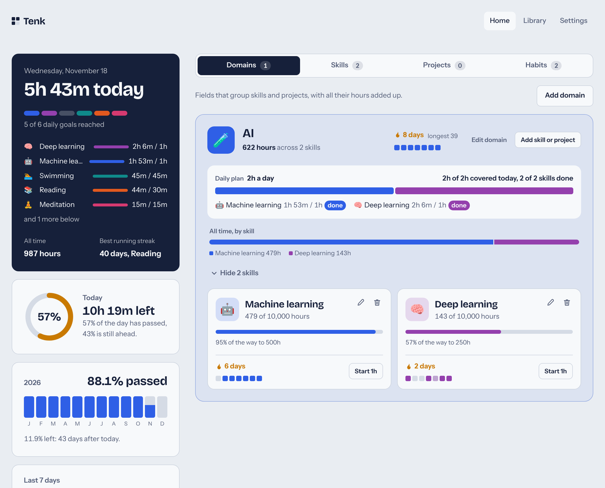
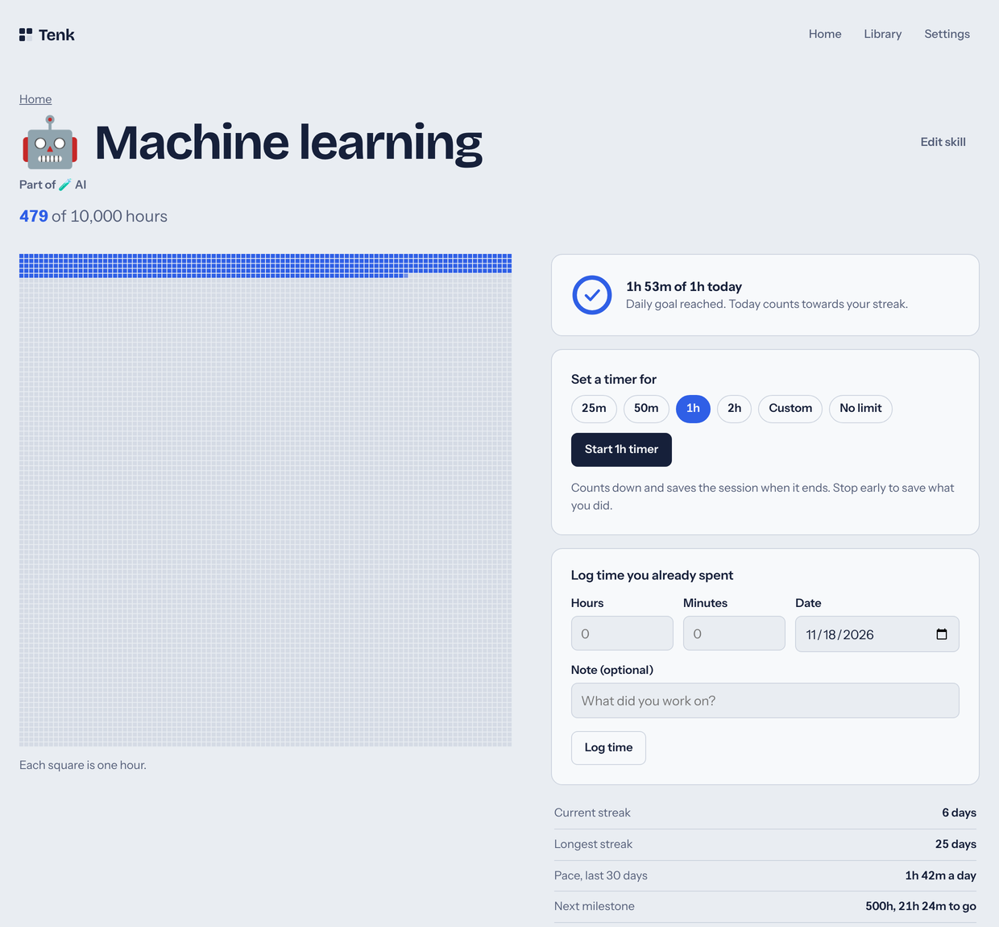
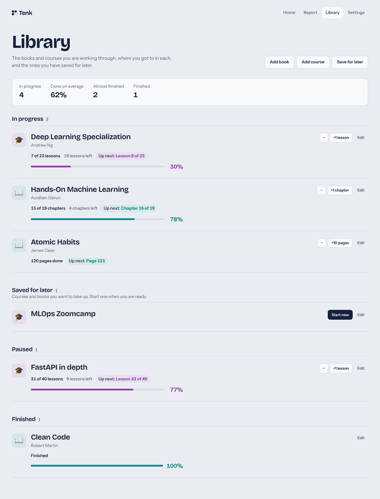
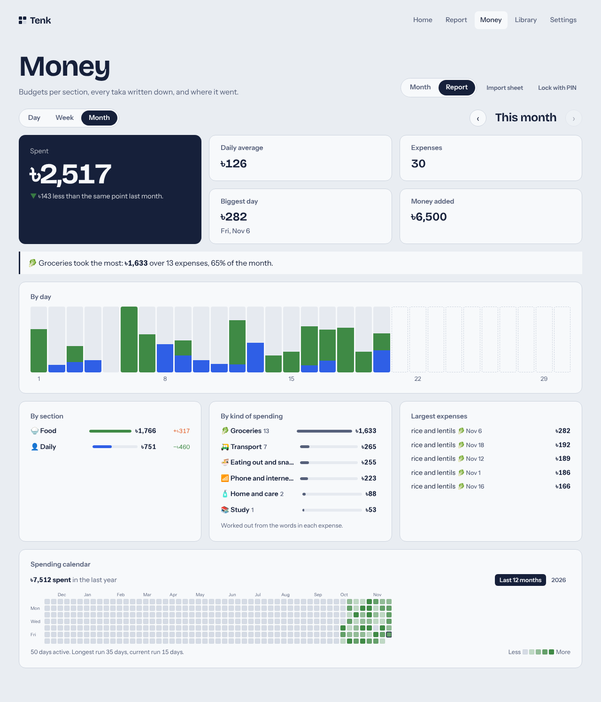
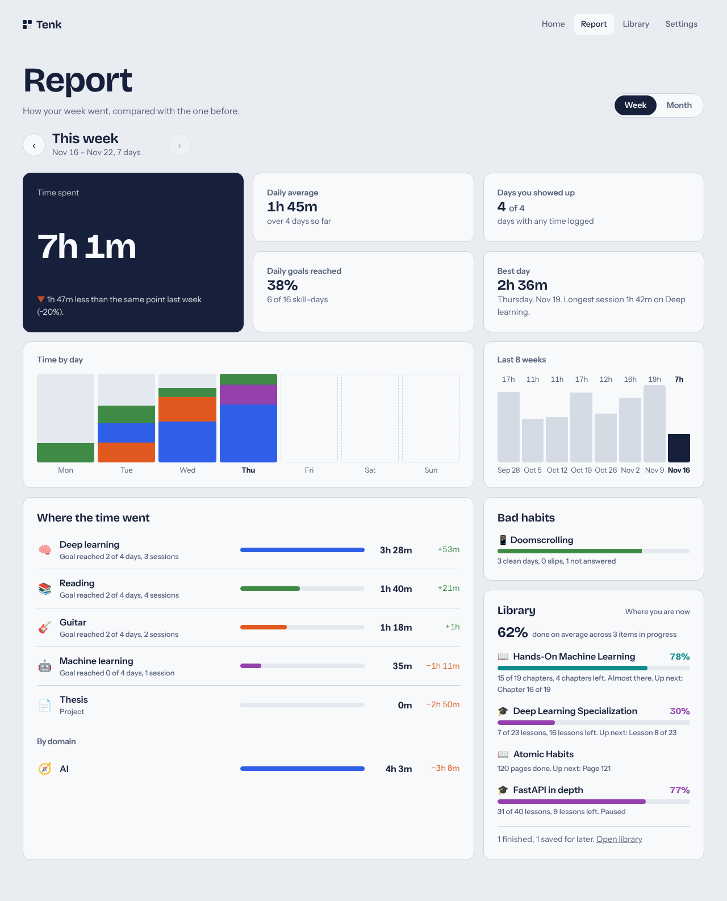
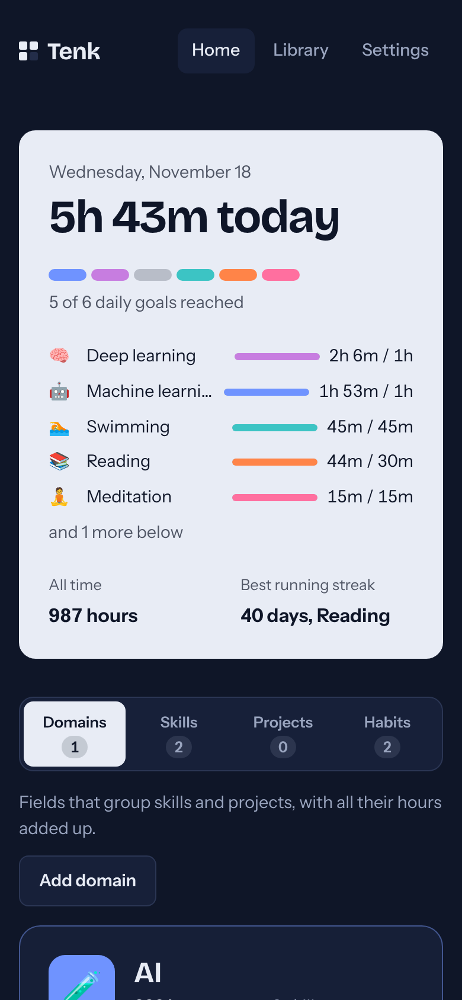

# Tenk — 10,000 Hours Tracker

> **Track the hours you put into a skill on the way to 10,000, and the habits you keep every day.**

[](https://github.com/himel7009/tenk-hours/actions/workflows/deploy.yml)
[](https://himel7009.github.io/tenk-hours/)
[](LICENSE)

**[✨ Open Tenk ✨](https://himel7009.github.io/tenk-hours/)**

Tenk is a web app and installable PWA for getting seriously good at things. Add a skill, group related skills under a domain, keep daily habits, and time every session with a countdown timer. Each skill fills a grid of 10,000 squares hour by hour, every skill, habit and domain can keep its own streak, and a weekly routine sets which days you work on what. A Library keeps your place in the books and courses you are working through, and the ones you want to take up next.

Tenk works without an account, storing everything in your browser. Sign in with Google or an email and password and your data syncs across your devices.

---

## 📸 Screenshots

### Dashboard

An overview rail with today's time against each daily goal, day and year progress and a 7-day chart, next to your domains, skills, projects and habits in tabs.



### Skill page

The 10,000-hour grid, today's goal, a countdown timer, manual logging, streaks, pace and a projected finish date.



### Library

Books and courses in progress with the percent done, what is left, the lesson or chapter up next, a bookmark of where you are, and the ones saved for later.



### Money

Budgets per section, spending written as "130 bus", and a report of where it went.



### Report

How a week or month went, against the one before, with a day-by-day chart and a trend of recent weeks or months.



### Mobile and dark theme

<p align="center">
  
</p>

---

## ⚡ Features

### Tracking

- **🎯 Skills and habits**: Long-term skills count towards 10,000 hours; habits are about showing up every day. Each has its own emoji and colour.
- **🛠️ Projects**: Time the work you do on a project, with no target, just the hours you put in and a daily streak. Every project is in the Projects tab and first on Today, whichever domain it sits in. Switch any skill to a project or back.
- **🚫 Bad habits**: Habits you want to quit, with a daily yes or no check-in, a streak of clean days and your clean rate over the last 30 days, optionally hidden behind a PIN.
- **🧭 Domains**: Group related skills and projects under a field, such as AI holding machine learning and deep learning. A domain shows the combined hours of everything in it, a daily plan made of its skills' daily goals with today's progress against it, and a streak of its own.
- **🟩 Activity calendar**: A GitHub-style year of squares, one per day, shaded by the time you put in. For everything together, for each domain and for each skill, habit and project, with past years a click away.
- **💸 Money**: Budgets per section (personal, meal, fund, your own), expenses written as "130 bus", money moved between sections, what is left and a fair daily amount, a report by day, week or month with spending by kind, and import from a monthly expense sheet.
- **☀️ Today and to-dos**: The home page opens on today: a to-do list, then only the domains and trackers planned for today.
- **🗓 Weekly routine**: Plan which days you study each domain, so you can go deep on a few things a day instead of a little of everything. Days off never break a streak.
- **🔥 Optional streaks**: Keep a streak on what you do every day and switch it off where it only adds pressure. Projects can keep one too.
- **📊 Weekly and monthly report**: Total time against the same point last week or month, daily average, days you showed up, goals reached, a day-by-day chart, a trend of recent weeks or months, and a breakdown by skill, project and domain, and where each book and course stands.
- **⏱ Countdown timer**: Pick 25m, 50m, 1h, 2h or your own length down to the second, and pause it when you step away. Turn on rounds to split long stretches Pomodoro style (25 + 5 or 50 + 10); only focus time is saved, never the breaks. The session saves itself when the time is up, with a chime and a notification. There is a stopwatch and manual logging too, and every session can be edited afterwards.
- **🔥 Streaks with daily goals**: Every skill, habit and domain can keep its own streak. A day only counts once its daily goal is reached (one hour by default), and planned days off never break it.

### Seeing progress

- **📈 Dashboard**: Today's time against each daily goal, a 7-day chart split by skill, and a comparison with the week before, in an overview that stays beside your trackers.
- **📅 Day and year progress**: How much of today and of the year has passed, and how much is left.
- **⬛ 10,000-hour grid**: One square per hour on every skill page.
- **🏁 Milestones and projections**: Hour milestones for skills, streak milestones for habits, a 26-week activity calendar and a projected date for reaching your target.

### Library

- **📚 Books and courses**: Progress in chapters, pages or lessons with the percent done and what is left, the one to start on next, a free-text bookmark ("Video 12 at 34:10"), notes and a link to the course or playlist.
- **🔖 Saved for later**: Keep courses and books you have found but not started. Start one with a click when you are ready.

### Your data

- **☁️ Optional cloud sync**: Sign in with Google or email to keep every device in step. Works offline and catches up when the connection returns.
- **🔒 Private by default**: No account needed. Synced data is protected by per-user row level security. One-click JSON backup and restore.
- **📱 Installable PWA**: Add it to your phone or desktop home screen.

---

## 🚀 Getting started

### Prerequisites

- Node.js 22 or newer
- npm

### Local development

```sh
git clone https://github.com/himel7009/tenk-hours.git
cd tenk-hours
npm install
npm run dev
```

The app runs on-device only until you add Supabase settings; see [Cloud sync](#️-cloud-sync).

### Scripts

| Command           | What it does                       |
| ----------------- | ---------------------------------- |
| `npm run dev`     | Start the Vite dev server          |
| `npm test`        | Run unit tests with Vitest         |
| `npm run lint`    | Lint code with ESLint              |
| `npm run format`  | Format codebase with Prettier      |
| `npm run build`   | Type-check and build to `dist/`    |
| `npm run preview` | Serve the production build locally |

---

## 🏗 Architecture

**Stack**: React 19, TypeScript, Vite, Zustand, CSS Modules, Vitest, Supabase (Postgres and Auth), GitHub Actions and GitHub Pages.

```
src/
  app/        App shell, router and theme wiring
  components/ Shared UI primitives (Button, Dialog, Field, Toast)
  data/       Backup export and import with validation
  domain/     Pure logic: dates, streaks, stats, domains, dashboard, time progress, library
  features/   Feature modules: dashboard, domains, skills, sessions, timer, progress, library, account, settings
  store/      Zustand stores; trackerStore is persisted to localStorage
  styles/     Design tokens and global styles
  sync/       Supabase client, auth and the sync engine
supabase/
  migrations/ Database schema and row level security policies
  tests/      SQL tests for the access rules
```

- **Logic apart from UI**: `domain/` is plain TypeScript with unit tests and no React or storage. Components never compute streaks or totals themselves.
- **Local-first state**: every change is written to the device first and queued for sync, so the app is fully usable offline and without an account.
- **Versioned storage**: the persisted state carries a version and migration steps, so upgrades never lose a user's data.
- **Hash routing**: deep links work on GitHub Pages without server rewrites.

---

## ☁️ Cloud sync

Accounts and sync run on [Supabase](https://supabase.com). The app stays a static site; the browser talks to the database directly, and every access rule is enforced by Postgres.

- **Sync engine**: pushes the local queue, then pulls rows changed since the device's last cursor. Each synced table keeps its own cursor.
- **Conflicts**: last write wins per row. Deletes are soft so they reach every device.
- **Security**: row level security limits each user to their own rows, check constraints bound what can be stored, and only the publishable key ships to the browser.
- **Optional**: without the two `VITE_SUPABASE_*` variables the build has no account features.

Setup takes about 15 minutes: see [`docs/cloud-setup.md`](docs/cloud-setup.md).

---

## 🌐 Deployment

[`.github/workflows/deploy.yml`](.github/workflows/deploy.yml) lints, tests, builds and deploys to GitHub Pages on every push to `main`. Database migrations in `supabase/migrations/` are applied to the Supabase project before the code that needs them is pushed.

Live: **[https://himel7009.github.io/tenk-hours/](https://himel7009.github.io/tenk-hours/)**

---

## 📱 Install as an app

- **Android**: open the site in Chrome and tap **Add to Home screen**.
- **iOS**: open it in Safari, tap the share icon and choose **Add to Home Screen**.
- **Desktop**: click the install icon in the browser's address bar.

---

## 🗒 Changelog

See [CHANGELOG.md](CHANGELOG.md) for what changed in each release.

## 📄 License

[MIT](LICENSE)
